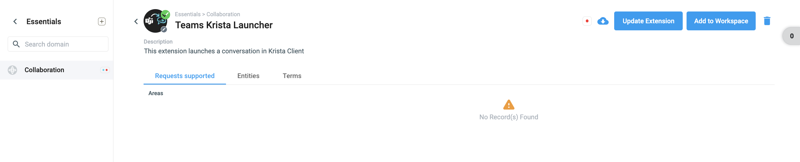
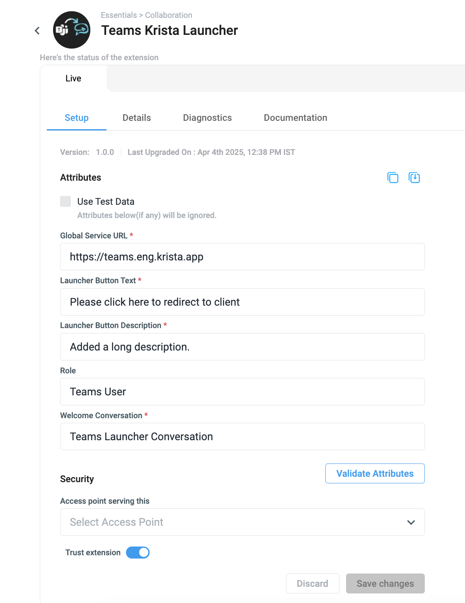
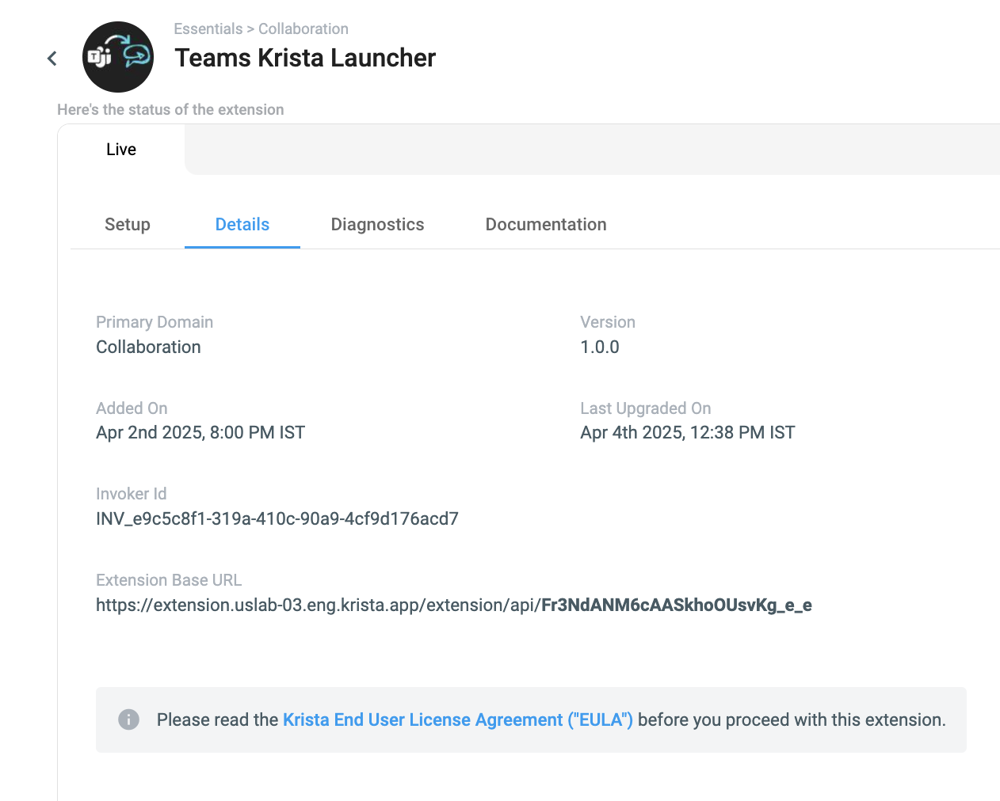

# Extension Configuration

## Overview

This page provides step-by-step instructions for configuring the Teams Krista Launcher extension in your Krista workspace. Proper configuration ensures seamless integration between Microsoft Teams and the Krista platform.

## Configuration Parameters

| Parameter | Type | Required | Description | Example |
|-----------|------|----------|-------------|---------|
| Global Service URL | Text | Yes | The URL of the Teams Global Service deployed for your environment | `https://teams.krista.app` |
| Launcher button text | Text | Yes | The text displayed on the launch button in the adaptive card | `Continue in Krista` |
| Launcher button description | Text | Yes | The description text displayed in the adaptive card containing the button | `Click to continue your conversation` |
| Role | Text | No | The role assigned to users accessing the conversation (default: Guest) | `Guest` |
| Welcome Conversation | Text | Yes | The name of the conversation executed when Krista client is launched | `Welcome Conversation` |

## Global Service URL by Environment

| Environment | URL |
|-------------|-----|
| **Engineering** | `https://teams.eng.krista.app` |
| **POC** | `https://teams.poc.krista.app` |
| **US Production** | `https://teams.krista.app` |

## Step-by-Step Setup

### Step 1: Add the Extension to Your Workspace

1. Navigate to **Catalog > Essentials > Collaboration > Extensions**
2. Select **Teams Krista Launcher**
3. Click **Add to Workspace**

### Step 2: Configure Extension Settings

After adding the extension to your workspace, you will see the setup page:

1. **Global Service URL**: Enter the appropriate URL for your environment
2. **Launcher button text**: Enter the text for the launch button
3. **Launcher button description**: Enter the description for the adaptive card
4. **Role**: Specify the role for users (ensure this role has access to the welcome conversation)
5. **Welcome Conversation**: Enter the name of your welcome conversation

### Step 3: Validate and Save

1. Click **Validate Attributes** to verify your configuration
2. In the **Security** panel, select the access point the extension runs on
3. Enable the **Trust extension** toggle to grant access
4. Click **Save changes**

### Step 4: Note the Invoker ID

Under the **Details** tab, note the **Invoker ID**. You will need this ID to register the extension with the Teams bot app.

## Welcome Conversation Requirements

The welcome conversation must meet the following requirements:

1. **First Step**: Must be an "Ask a Person" step
2. **Input Field**: Must have a single text input field
3. **Role Access**: The configured role must have access to this conversation
4. **Unique Name**: The conversation name must be unique within the execution mode

> **📝 Note**: The user's message from Teams becomes the first input to this conversation.

## Security Considerations

### 1. Trust Extension
Enable the "Trust extension" toggle only after verifying the configuration is correct.

### 2. Access Point Selection
Select the appropriate access point based on your security requirements.

### 3. Role Configuration
Ensure the configured role has the minimum necessary permissions to access the welcome conversation.

## Troubleshooting

### Invalid Global Service URL

**Error**: `Invalid Global Service URL: The URL format is incorrect.`

**Solution**: Verify the URL follows the correct format and matches your environment. See [Error Reference](pages/ErrorReference.md) for details.

### Conversation Not Found

**Error**: `Conversation "[name]" not found.`

**Solution**: Verify the conversation exists and is spelled correctly. The conversation must be available in LIVE mode.

### Multiple Conversations Found

**Error**: `Multiple conversations found with the same name.`

**Solution**: Ensure the welcome conversation name is unique within the execution mode.

## See Also

- [Authentication](pages/Authentication.md) - Authentication and security information
- [Teams App Setup](pages/TeamsAppSetup.md) - Microsoft Teams app installation
- [Prerequisites](pages/Prerequisites.md) - Requirements before installation

