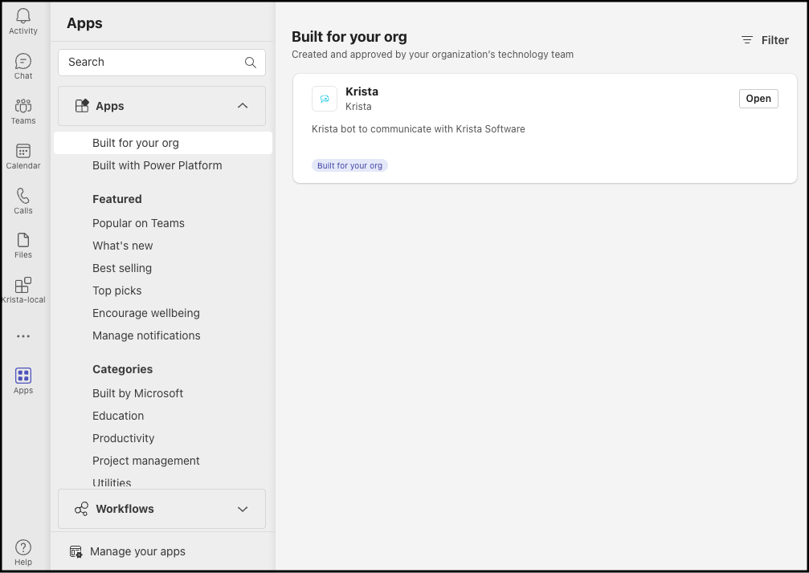
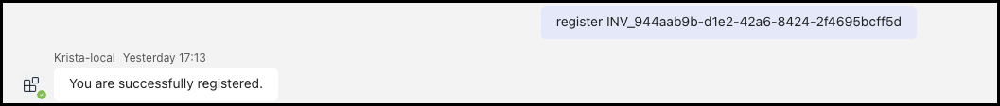
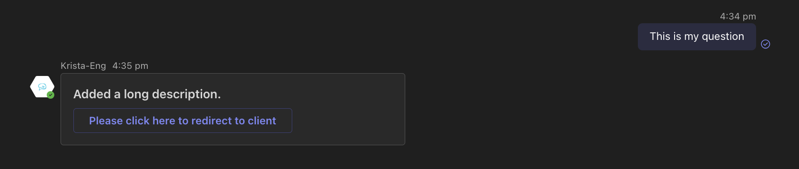
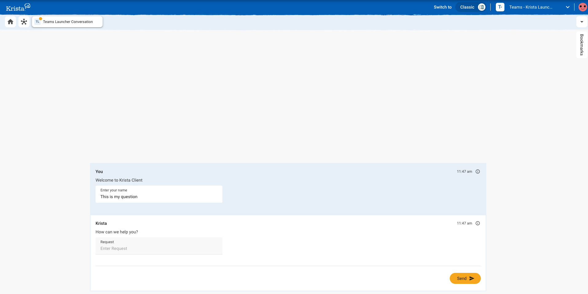
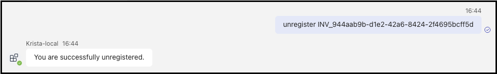

# Teams App Setup

## Overview

This page provides step-by-step instructions for setting up the Krista app in Microsoft Teams and registering it with your Krista workspace invoker.

## Prerequisites

Before setting up the Teams app, ensure you have:

- ✅ Valid Microsoft Teams account with access to the Teams app
- ✅ Access to your organization's Teams admin center (for app deployment)
- ✅ Krista workspace with the Teams Krista Launcher extension configured
- ✅ Invoker ID from the extension configuration (see [Extension Configuration](pages/ExtensionConfiguration.md))
- ✅ Workspace Admin privileges for register/unregister operations

## Step 1: Add Krista App to Microsoft Teams

### For Individual Users

1. Open Microsoft Teams
2. Navigate to **Apps** in the left sidebar
3. Click **Build for your org** or search for "Krista"
4. Click **Add** to install the Krista app

### For Organization-Wide Deployment

1. Access the Microsoft Teams Admin Center
2. Navigate to **Teams apps > Manage apps**
3. Search for "Krista" and select the app
4. Configure app policies as needed
5. Deploy to your organization



## Step 2: Register the Invoker

After adding the Krista app to Teams, you must register it with your Krista workspace invoker.

> **⚠️ Important**: Only Workspace Admins can use the register command.

### Register Command

Send the following message in the Krista app chat:

```
register <Invoker ID>
```

**Example**:
```
register inv_abc123def456
```



### Successful Registration

Upon successful registration:
- The Krista app is linked to your workspace invoker
- Users can now send messages to trigger Krista conversations
- Adaptive cards with launch buttons will be displayed

## Step 3: Using the Extension

### Sending Messages

1. Open the Krista app in Microsoft Teams
2. Type your question or message
3. The message is sent to the configured welcome conversation
4. An adaptive card with a launch button is displayed



### Launching Krista Client

1. Click the launch button in the adaptive card
2. You are redirected to the Krista Client
3. Continue your conversation in the full Krista interface



## Unregistering the Invoker

To unregister the invoker from the Teams app:

> **⚠️ Important**: Only Workspace Admins can use the unregister command.

### Unregister Command

Send the following message in the Krista app chat:

```
unregister <Invoker ID>
```

**Example**:
```
unregister inv_abc123def456
```



### After Unregistering

- The Krista app is no longer linked to the invoker
- Users cannot send messages to trigger conversations
- Previously generated launch buttons become invalid

## Troubleshooting

### Registration Failed

**Symptom**: Register command returns an error

**Possible Causes**:
- User is not a Workspace Admin
- Invalid Invoker ID
- Extension not properly configured

**Solution**:
1. Verify you have Workspace Admin privileges
2. Check the Invoker ID in the extension configuration
3. Ensure the extension is properly configured and saved

### Messages Not Processed

**Symptom**: Messages sent but no response received

**Possible Causes**:
- Invoker not registered
- Global Service URL incorrect
- Welcome conversation not configured

**Solution**:
1. Verify the invoker is registered
2. Check the Global Service URL in extension configuration
3. Verify the welcome conversation exists and is accessible

### Launch Button Not Working

**Symptom**: Clicking launch button shows error or redirects incorrectly

**Possible Causes**:
- Session expired
- Account deleted
- Cookie conflicts

**Solution**:
1. Send a new message to create a fresh session
2. Clear browser cookies and try again
3. Verify your account exists in the Krista workspace

## Best Practices

### 1. Use Descriptive Button Text
Configure clear, action-oriented button text (e.g., "Continue in Krista" or "Open Full Conversation").

### 2. Keep Welcome Conversation Simple
Ensure the welcome conversation's first step is a simple text input to capture the user's initial message.

### 3. Test Before Deployment
Test the full flow (message → adaptive card → launch → Krista Client) before deploying to all users.

### 4. Document the Invoker ID
Keep a record of the Invoker ID for future reference when registering or unregistering.

## See Also

- [Extension Configuration](pages/ExtensionConfiguration.md) - Setup and configuration guide
- [Authentication](pages/Authentication.md) - Authentication and security information
- [Prerequisites](pages/Prerequisites.md) - Requirements before installation

